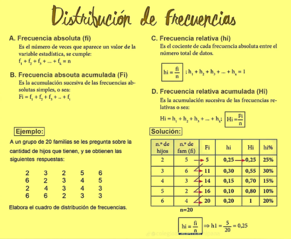
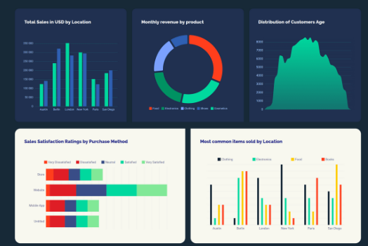

```{r setup}
options(
  knitr.table.format = "html",
  scipen = 999
)
```

```{=html}
<div style="position:absolute; top:10px; right:10px;">

</div>
```

```{=html}
<style>
body{
  background-color:#92cbe0;
  font-size:130%;
  text-align:justify;
}
</style>
```

# .Cargar paquetes

```{r}
ipak <- function(pkg){

  options(repos = c(CRAN="[https://cloud.r-project.org](https://cloud.r-project.org)"))

  new.pkg <- pkg[!(pkg %in% rownames(installed.packages()))]

  if(length(new.pkg)) install.packages(new.pkg, dependencies = TRUE)

  invisible(lapply(pkg, function(p)
    suppressPackageStartupMessages(library(p, character.only = TRUE))
  ))
}

packages <- c("tidyverse","kableExtra","psych","readxl")

ipak(packages)

```



# .Introducción

**Distribución de Frecuencias**

*Concepto*

Una distribución de frecuencias es una forma de organizar, resumir y presentar datos estadísticos mediante tablas que muestran el número de observaciones que pertenecen a cada categoría o intervalo de una variable.

Formalmente, si se tiene un conjunto de datos:

$$X = \{x_1, x_2, x_3, \dots, x_n\}$$

la distribución de frecuencias permite identificar cuántas veces aparece cada valor o intervalo dentro del conjunto de datos para resumir grandes volúmenes de información, identificar patrones, facilitar la construcción de gráficos estadísticos y calcular medidas descriptivas.

**Elementos y Tipos de Frecuencia**

- **Frecuencia absoluta (**$f_i$): Número de veces que aparece un valor o categoría en el conjunto de datos, cumpliendo $\sum_{i=1}^{k} f_i = n$.
- **Frecuencia relativa (**$h_i$): Proporción del total de datos que pertenecen a una categoría: $$h_i = \frac{f_i}{n}, \quad \text{con } \sum_{i=1}^{k} h_i = 1$$ En porcentaje: $h_i(\%) = \frac{f_i}{n} \times 100$.
- **Frecuencia acumulada (**$F_i$): Suma progresiva de las frecuencias absolutas hasta una clase determinada: $$F_i = \sum_{j=1}^{i} f_j, \quad \text{con } F_k = n$$
- **Frecuencia relativa acumulada (**$H_i$): Proporción acumulada hasta la clase $i$: $$H_i = \sum_{j=1}^{i} h_j = \frac{F_i}{n}, \quad \text{con } H_k = 1$$

**Distribución de Frecuencias para Datos Agrupados**

Cuando el conjunto de datos es continuo o amplio, se agrupan en intervalos $(L_i, L_s)$:

- **Número de clases (Regla de Sturges):** $k = 1 + 3.322 \log_{10}(n)$
- **Rango y amplitud:** $R = X_{\max} - X_{\min}$ y $A = \frac{R}{k}$
- **Marca de clase:** $m_i = \frac{L_i + L_s}{2}$

------------------------------------------------------------------------

# .Bajar el Dataset


Base de datos `sector` (`Datos/sector.xlsx`).

# .Leer el Dataset

{fig-align="center"}

```{r}
sector <- read_excel("Datos/sector.xlsx")
names(sector) <- trimws(names(sector))
```

# .Conocer el Dataset

**Mostrar algunas filas del dataset**

```{r}
head(sector)
```

**Número de variables**

```{r}
sector %>% names() %>% length()
```

**Nombres de las variables**

```{r}
names(sector)
```

**Estructura de las variables**

```{r}
glimpse(sector)
```

**Transformar las variables**

```{r}
sector$SECTOR <- as.factor(sector$SECTOR)

sector$NIVEL <- factor(
  sector$NIVEL,
  levels = c("Baja", "Media", "Alta"),
  ordered = TRUE
)

sector$SATISFECHO <- factor(
  sector$SATISFECHO,
  levels = c("Muy Insatisfecho", "Insatisfecho", "Neutral", "Satisfecho", "Muy Satisfecho"),
  ordered = TRUE
)

sector$PARTICIPACION <- factor(
  sector$PARTICIPACION,
  levels = c("Nunca", "Rara vez", "A veces", "Frecuentemente", "Siempre"),
  ordered = TRUE
)
```

**Nueva estructura de las variables**

```{r}
glimpse(sector)
```

------------------------------------------------------------------------

# .Tablas y Gráficas

{fig-align="center"}

**Variable Nominal**

::: callout-warning
La variable nominal tiene solo frecuencia absoluta, relativa y porcentaje.
:::

**Análisis de frecuencias de SECTOR**

```{r}
tabla_sec <- tibble(Sector = sector$SECTOR) %>%
  group_by(Sector) %>%
  summarise(fi = n(), .groups = "drop") %>%
  mutate(
    hi = round(fi / sum(fi), 4),
    Porcentaje = paste0(round(hi * 100, 2), "%"),
    Sector = as.character(Sector)
  )

tot_sec <- tibble(
  Sector = "Total",
  fi = sum(tabla_sec$fi),
  hi = round(sum(tabla_sec$hi), 4),
  Porcentaje = paste0(round(sum(tabla_sec$hi) * 100, 2), "%")
)

bind_rows(tabla_sec, tot_sec) %>%
  knitr::kable(
    col.names = c("Sector", "$f_i$", "$h_i$", "Porcentaje"),
    align = c("l", "c", "c", "c")
  )
```

------------------------------------------------------------------------

**Variable OrdinalV**

::: callout-tip
La variable ordinal tiene los cuatro tipos de frecuencias.
:::

**Distribución de frecuencias según NIVEL**

```{r}
tabla_niv <- tibble(Nivel = sector$NIVEL) %>%
  group_by(Nivel) %>%
  summarise(fi = n(), .groups = "drop") %>%
  mutate(
    hi = round(fi / sum(fi), 4),
    Porcentaje = paste0(round(hi * 100, 2), "%"),
    Fi = cumsum(fi),
    Hi = round(cumsum(hi), 4)
  ) %>%
  mutate(
    Nivel = as.character(Nivel),
    Fi = as.character(Fi),
    Hi = as.character(Hi)
  )

tot_niv <- tibble(
  Nivel = "Total",
  fi = sum(tabla_niv$fi),
  hi = round(sum(tabla_niv$hi), 4),
  Porcentaje = paste0(round(sum(tabla_niv$hi) * 100, 2), "%"),
  Fi = "",
  Hi = ""
)

bind_rows(tabla_niv, tot_niv) %>%
  knitr::kable(
    col.names = c("Nivel", "$f_i$", "$h_i$", "Porcentaje", "$F_i$", "$H_i$"),
    align = c("l", "c", "c", "c", "c", "c")
  )
```

**Distribución de frecuencias según SATISFECHO**

```{r}
tabla_sat <- tibble(Satisfaccion = sector$SATISFECHO) %>%
  group_by(Satisfaccion) %>%
  summarise(fi = n(), .groups = "drop") %>%
  mutate(
    hi = round(fi / sum(fi), 4),
    Porcentaje = paste0(round(hi * 100, 2), "%"),
    Fi = cumsum(fi),
    Hi = round(cumsum(hi), 4)
  ) %>%
  mutate(
    Satisfaccion = as.character(Satisfaccion),
    Fi = as.character(Fi),
    Hi = as.character(Hi)
  )

tot_sat <- tibble(
  Satisfaccion = "Total",
  fi = sum(tabla_sat$fi),
  hi = round(sum(tabla_sat$hi), 4),
  Porcentaje = paste0(round(sum(tabla_sat$hi) * 100, 2), "%"),
  Fi = "",
  Hi = ""
)

bind_rows(tabla_sat, tot_sat) %>%
  knitr::kable(
    col.names = c("Satisfacción", "$f_i$", "$h_i$", "Porcentaje", "$F_i$", "$H_i$"),
    align = c("l", "c", "c", "c", "c", "c")
  )
```

**Distribución de frecuencias según PARTICIPACION**

```{r}
tabla_par <- tibble(Participacion = sector$PARTICIPACION) %>%
  group_by(Participacion) %>%
  summarise(fi = n(), .groups = "drop") %>%
  mutate(
    hi = round(fi / sum(fi), 4),
    Porcentaje = paste0(round(hi * 100, 2), "%"),
    Fi = cumsum(fi),
    Hi = round(cumsum(hi), 4)
  ) %>%
  mutate(
    Participacion = as.character(Participacion),
    Fi = as.character(Fi),
    Hi = as.character(Hi)
  )

tot_par <- tibble(
  Participacion = "Total",
  fi = sum(tabla_par$fi),
  hi = round(sum(tabla_par$hi), 4),
  Porcentaje = paste0(round(sum(tabla_par$hi) * 100, 2), "%"),
  Fi = "",
  Hi = ""
)

bind_rows(tabla_par, tot_par) %>%
  knitr::kable(
    col.names = c("Participación", "$f_i$", "$h_i$", "Porcentaje", "$F_i$", "$H_i$"),
    align = c("l", "c", "c", "c", "c", "c")
  )
```

------------------------------------------------------------------------

**Variable Discreta**

::: callout-warning
La variable discreta tiene los cuatro tipos de frecuencias.
:::

**Distribución de frecuencias según HIJOS**

```{r}
tabla_hij <- tibble(Hijos = sector$HIJOS) %>%
  group_by(Hijos) %>%
  summarise(fi = n(), .groups = "drop") %>%
  arrange(Hijos) %>%
  mutate(
    hi = round(fi / sum(fi), 4),
    Porcentaje = paste0(round(hi * 100, 2), "%"),
    Fi = cumsum(fi),
    Hi = round(cumsum(hi), 4)
  ) %>%
  mutate(
    Hijos = as.character(Hijos),
    Fi = as.character(Fi),
    Hi = as.character(Hi)
  )

tot_hij <- tibble(
  Hijos = "Total",
  fi = sum(tabla_hij$fi),
  hi = round(sum(tabla_hij$hi), 4),
  Porcentaje = paste0(round(sum(tabla_hij$hi) * 100, 2), "%"),
  Fi = "",
  Hi = ""
)

bind_rows(tabla_hij, tot_hij) %>%
  knitr::kable(
    col.names = c("N° Hijos", "$f_i$", "$h_i$", "Porcentaje", "$F_i$", "$H_i$"),
    align = c("l", "r", "r", "r", "r", "r")
  )
```

**Distribución de frecuencias según EXPERIENCIA**

```{r}
tabla_exp <- tibble(Experiencia = sector$EXPERIENCIA) %>%
  group_by(Experiencia) %>%
  summarise(fi = n(), .groups = "drop") %>%
  arrange(Experiencia) %>%
  mutate(
    hi = round(fi / sum(fi), 4),
    Porcentaje = paste0(round(hi * 100, 2), "%"),
    Fi = cumsum(fi),
    Hi = round(cumsum(hi), 4)
  ) %>%
  mutate(
    Experiencia = as.character(Experiencia),
    Fi = as.character(Fi),
    Hi = as.character(Hi)
  )

tot_exp <- tibble(
  Experiencia = "Total",
  fi = sum(tabla_exp$fi),
  hi = round(sum(tabla_exp$hi), 4),
  Porcentaje = paste0(round(sum(tabla_exp$hi) * 100, 2), "%"),
  Fi = "",
  Hi = ""
)

bind_rows(tabla_exp, tot_exp) %>%
  knitr::kable(
    col.names = c("Experiencia", "$f_i$", "$h_i$", "Porcentaje", "$F_i$", "$H_i$"),
    align = c("l", "r", "r", "r", "r", "r")
  )
```

------------------------------------------------------------------------

**Variable Continua**

::: callout-important
La variable continua se tabula con intervalos.
:::

**Distribución de frecuencias para EDAD**

```{r}
x <- sector$EDAD
k <- ceiling(1 + 3.322 * log10(length(x)))
A <- ceiling((max(x) - min(x)) / k)
Xmin <- min(x)
Xmax <- Xmin + k * A
m1 <- (Xmin + (Xmin + A)) / 2

interv <- cut(x = x, breaks = seq(Xmin, Xmax, by = A), include.lowest = TRUE)

tabla_edad <- tibble(Edad = interv) %>%
  group_by(Edad, .drop = FALSE) %>%
  summarise(fi = n(), .groups = "drop") %>%
  mutate(
    hi = round(fi / sum(fi), 4),
    mi = seq(m1, by = A, length.out = n()) %>% as.character(),
    Fi = cumsum(fi) %>% as.character(),
    Hi = round(cumsum(fi / sum(fi)), 4) %>% as.character(),
    Edad = as.character(Edad)
  ) %>%
  relocate(Edad, mi, fi) %>%
  add_row(Edad = "Total", mi = "", fi = sum(.$fi), hi = sum(.$hi), Fi = "", Hi = "")

tabla_edad %>%
  knitr::kable(
    col.names = c("Edad", "$m_i$", "$f_i$", "$h_i$", "$F_i$", "$H_i$"),
    align = c("l", "r", "r", "r", "r", "r")
  ) %>%
  kableExtra::kable_styling(full_width = FALSE) %>%
  kableExtra::add_header_above(c("Distribución de frecuencias para la variable Edad" = 6))
```

**Distribución de frecuencias para SALARIO**

```{r}
x <- sector$SALARIO
k <- ceiling(1 + 3.322 * log10(length(x)))
A <- ceiling((max(x) - min(x)) / k)
Xmin <- min(x)
Xmax <- Xmin + k * A
m1 <- (Xmin + (Xmin + A)) / 2

interv <- cut(x = x, breaks = seq(Xmin, Xmax, by = A), include.lowest = TRUE)

tabla_sal <- tibble(Salario = interv) %>%
  group_by(Salario, .drop = FALSE) %>%
  summarise(fi = n(), .groups = "drop") %>%
  mutate(
    hi = round(fi / sum(fi), 4),
    mi = seq(m1, by = A, length.out = n()) %>% as.character(),
    Fi = cumsum(fi) %>% as.character(),
    Hi = round(cumsum(fi / sum(fi)), 4) %>% as.character(),
    Salario = as.character(Salario)
  ) %>%
  relocate(Salario, mi, fi) %>%
  add_row(Salario = "Total", mi = "", fi = sum(.$fi), hi = sum(.$hi), Fi = "", Hi = "")

tabla_sal %>%
  knitr::kable(
    col.names = c("Salario", "$m_i$", "$f_i$", "$h_i$", "$F_i$", "$H_i$"),
    align = c("l", "r", "r", "r", "r", "r")
  ) %>%
  kableExtra::kable_styling(full_width = FALSE) %>%
  kableExtra::add_header_above(c("Distribución de frecuencias para la variable Salario" = 6))
```

**Distribución de frecuencias para LABORAL**

```{r}
x <- sector$LABORAL
k <- ceiling(1 + 3.322 * log10(length(x)))
A <- ceiling(((max(x) - min(x)) / k) * 100) / 100
Xmin <- min(x)
Xmax <- Xmin + k * A
m1 <- (Xmin + (Xmin + A)) / 2

interv <- cut(x = x, breaks = seq(Xmin, Xmax, by = A), include.lowest = TRUE)

tabla_lab <- tibble(Laboral = interv) %>%
  group_by(Laboral, .drop = FALSE) %>%
  summarise(fi = n(), .groups = "drop") %>%
  mutate(
    hi = round(fi / sum(fi), 4),
    mi = seq(m1, by = A, length.out = n()) %>% as.character(),
    Fi = cumsum(fi) %>% as.character(),
    Hi = round(cumsum(fi / sum(fi)), 4) %>% as.character(),
    Laboral = as.character(Laboral)
  ) %>%
  relocate(Laboral, mi, fi) %>%
  add_row(Laboral = "Total", mi = "", fi = sum(.$fi), hi = sum(.$hi), Fi = "", Hi = "")

tabla_lab %>%
  knitr::kable(
    col.names = c("Laboral", "$m_i$", "$f_i$", "$h_i$", "$F_i$", "$H_i$"),
    align = c("l", "r", "r", "r", "r", "r")
  ) %>%
  kableExtra::kable_styling(full_width = FALSE) %>%
  kableExtra::add_header_above(c("Distribución de frecuencias para la variable Laboral" = 6))
```

**Distribución de frecuencias para PROGRMAS**

```{r}
x <- sector$PROGRMAS
k <- ceiling(1 + 3.322 * log10(length(x)))
A <- ceiling(((max(x) - min(x)) / k) * 1000) / 1000
Xmin <- min(x)
Xmax <- Xmin + k * A
m1 <- (Xmin + (Xmin + A)) / 2

interv <- cut(x = x, breaks = seq(Xmin, Xmax, by = A), include.lowest = TRUE)

tabla_prg <- tibble(Programas = interv) %>%
  group_by(Programas, .drop = FALSE) %>%
  summarise(fi = n(), .groups = "drop") %>%
  mutate(
    hi = round(fi / sum(fi), 4),
    mi = seq(m1, by = A, length.out = n()) %>% as.character(),
    Fi = cumsum(fi) %>% as.character(),
    Hi = round(cumsum(fi / sum(fi)), 4) %>% as.character(),
    Programas = as.character(Programas)
  ) %>%
  relocate(Programas, mi, fi) %>%
  add_row(Programas = "Total", mi = "", fi = sum(.$fi), hi = sum(.$hi), Fi = "", Hi = "")

tabla_prg %>%
  knitr::kable(
    col.names = c("Programas", "$m_i$", "$f_i$", "$h_i$", "$F_i$", "$H_i$"),
    align = c("l", "r", "r", "r", "r", "r")
  ) %>%
  kableExtra::kable_styling(full_width = FALSE) %>%
  kableExtra::add_header_above(c("Distribución de frecuencias para la variable Programas" = 6))
```

------------------------------------------------------------------------

**Tablas de contingencia**

```{r}
table_sec_niv <- table(sector$SECTOR, sector$NIVEL)
table_df <- as.data.frame.matrix(table_sec_niv)
table_df$Total <- rowSums(table_df)
total_fi <- sum(table_df$Total)
table_df <- rbind(table_df, Total = c(colSums(table_sec_niv), total_fi))

table_df %>%
  kable("html", caption = "Tabla de Frecuencias absolutas de SECTOR vs NIVEL") %>%
  kable_styling(
    bootstrap_options = c("striped", "hover", "condensed", "responsive"),
    full_width = FALSE,
    position = "center"
  ) %>%
  row_spec(nrow(table_df), bold = TRUE, color = "white", background = "green")
```

# .Referencias

- Wickham, Hadley, et al. 2019. *Welcome to the tidyverse*. JOSS 4: 1686. <https://doi.org/10.21105/joss.01686>.
- Wickham, Hadley, y Jennifer Bryan. 2025. *readxl: Read Excel Files*. <https://doi.org/10.32614/CRAN.package.readxl>.
- Revelle, William. 2026. *psych: Procedures for Psychological, Psychometric, and Personality Research*. <https://CRAN.R-project.org/package=psych>.
- Zhu, Hao. 2024. *kableExtra: Construct Complex Table with 'kable' and Pipe Syntax*. <https://doi.org/10.32614/CRAN.package.kableExtra>.
